# Cisco Packet Tracer labs

Five labs that build one small office network step by step: **VLANs → inter-VLAN routing → DHCP and NAT → ACLs → port security**. Each lab has the Packet Tracer file, the exact config, and screenshots of the real output proving it works (including one thing that didn't, and how I found it).

Built in Cisco Packet Tracer 9.0.

Part of my networking labs: [ping and traceroute](https://github.com/yaseenselemane/ping-and-traceroute) · [nmap](https://github.com/yaseenselemane/nmap-field-notes) · [WiFi survey](https://github.com/yaseenselemane/wifi-survey) · [Wireshark](https://github.com/yaseenselemane/wireshark-packet-lab) · **Packet Tracer** · [subnet calculator](https://github.com/yaseenselemane/subnet-calculator) · [vantage](https://github.com/yaseenselemane/vantage) · [Tier One (game)](https://github.com/yaseenselemane/tier-one-network-ops)

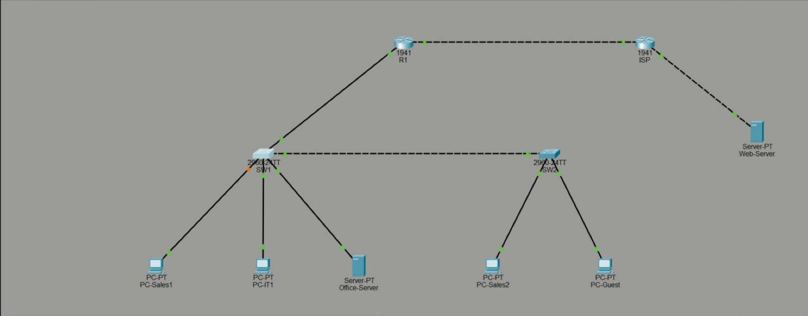

## The network

| Device | Role | Address |
|---|---|---|
| **R1** (1941) | Office router: routes between VLANs, DHCP, NAT, ACL | G0/1.10 `192.168.10.1` · G0/1.20 `192.168.20.1` · G0/1.30 `192.168.30.1` · G0/0 `203.0.113.2/30` |
| **ISP** (1941) | Stands in for the internet | G0/0 `203.0.113.1/30` · G0/1 `198.51.100.1` |
| **SW1, SW2** (2960) | Access switches, joined by an 802.1Q trunk | — |
| PC-Sales1, PC-Sales2 | VLAN 10 SALES | DHCP (`192.168.10.x`) |
| PC-IT1, Office-Server | VLAN 20 IT | DHCP / static `192.168.20.100` |
| PC-Guest | VLAN 30 GUEST | DHCP (`192.168.30.x`) |
| Web-Server | "The internet" | `198.51.100.10` |

| Port | Connects to |
|---|---|
| SW1 Fa0/1 | R1 G0/1 (trunk) |
| SW1 Fa0/2 ↔ SW2 Fa0/1 | trunk between switches |
| SW1 Fa0/3, 0/4, 0/5 | PC-Sales1, PC-IT1, Office-Server |
| SW2 Fa0/2, 0/3 | PC-Sales2, PC-Guest |

Full configs: [`configs/`](configs/) ([R1](configs/R1.txt) · [SW1](configs/SW1.txt) · [SW2](configs/SW2.txt) · [ISP](configs/ISP.txt))

---

## Lab 1: VLANs and trunking · [`.pkt`](lab-01-vlans-and-trunking/)

**Goal:** three departments on two switches, kept apart at layer 2, with one trunk carrying all of them.

```
vlan 10
 name SALES
interface fa0/2
 switchport mode trunk              ! carries every VLAN, tagged 802.1Q
interface fa0/3
 switchport mode access
 switchport access vlan 10          ! this desk port belongs to SALES
```

To prove isolation, I deliberately gave PC-Guest (VLAN 30) a **Sales** address, `192.168.10.12`, the same subnet as the Sales PCs.

| From PC-Sales1 to | Result | Why |
|---|---|---|
| PC-Sales2 (VLAN 10, other switch) | ✅ 3/3 | Same VLAN, carried across the trunk |
| PC-Guest (VLAN 30, *same subnet*) | ❌ 100% loss | Different VLAN = different broadcast domain. Matching IPs don't matter |
| PC-IT1 (VLAN 20) | ❌ | No router yet |

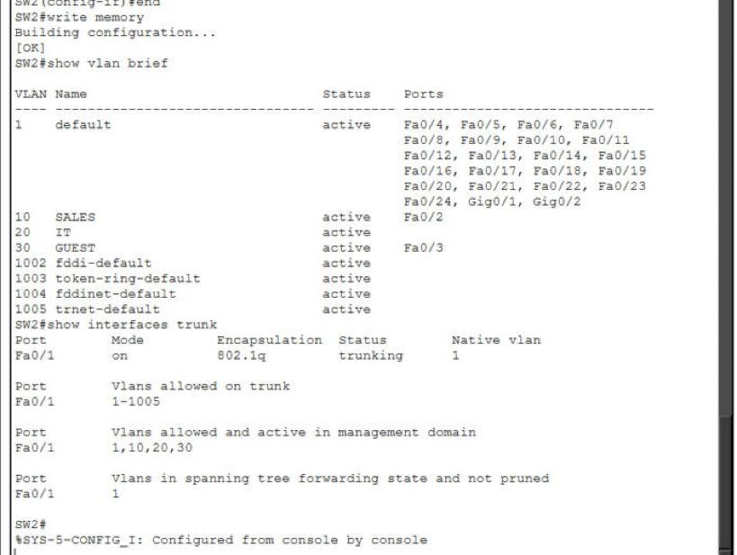
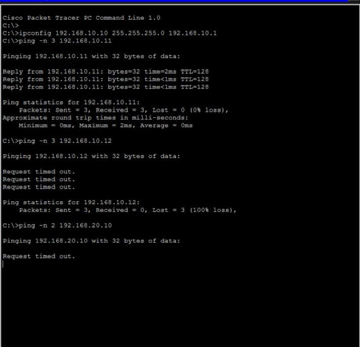

> Note: Packet Tracer auto-saved this file after I'd started lab 2, so it already contains R1's sub-interfaces. The switch config and the tests above are lab 1.

## Lab 2: Inter-VLAN routing (router-on-a-stick) · [`.pkt`](lab-02-inter-vlan-routing/)

**Goal:** let the VLANs talk, through one router port.

```
interface g0/1.10
 encapsulation dot1Q 10             ! frames tagged VLAN 10 belong to this sub-interface
 ip address 192.168.10.1 255.255.255.0
```

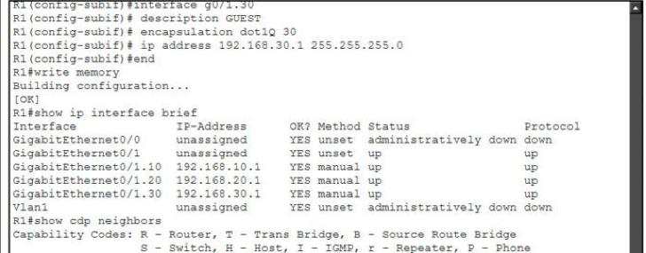

**It didn't work at first.** PC-Sales1 could ping its gateway (`192.168.10.1`), and R1 itself could ping PC-IT1, but Sales → IT timed out every time. Working through it:

1. Sales PC → its gateway: ✅, so the Sales side is fine.
2. SW1 `show interfaces trunk` and `show mac address-table`: VLAN 20 is allowed and forwarding, and the IT hosts are learned. Layer 2 is fine.
3. R1 → PC-IT1: ✅, so the router reaches VLAN 20.
4. PC-IT1's IP settings: **Default Gateway 0.0.0.0**.

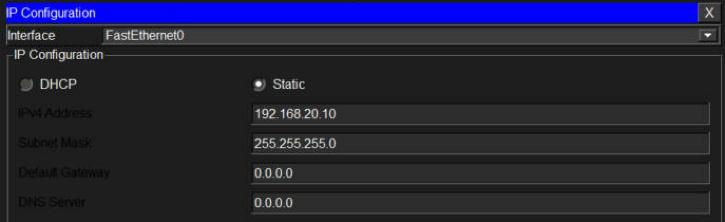

The ping *arrived* at PC-IT1, but its reply was going to a different subnet and it had **no gateway to send it to**. R1 could reach it only because R1 is on the same subnet. After setting the gateways:

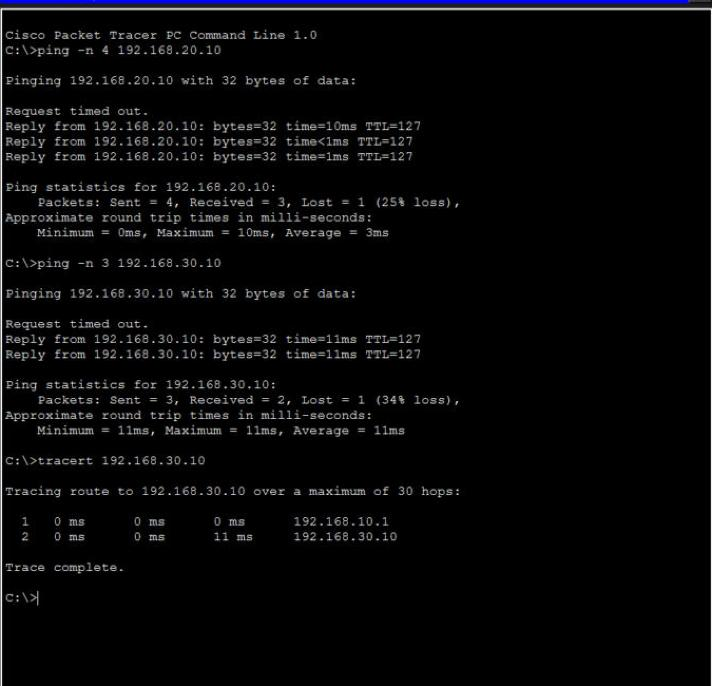

Replies now show **TTL 127**: PC-IT1 starts at 128 and R1 takes one off. `tracert` shows the single hop through `192.168.10.1`.

## Lab 3: DHCP and NAT · [`.pkt`](lab-03-dhcp-and-nat/)

**Goal:** R1 hands out addresses in every VLAN, and the whole office shares one public IP to reach "the internet".

```
ip dhcp excluded-address 192.168.10.1 192.168.10.9
ip dhcp pool SALES
 network 192.168.10.0 255.255.255.0
 default-router 192.168.10.1
!
interface g0/0
 ip nat outside
interface g0/1.10
 ip nat inside
access-list 1 permit 192.168.0.0 0.0.255.255
ip nat inside source list 1 interface g0/0 overload    ! PAT: everyone shares 203.0.113.2
ip route 0.0.0.0 0.0.0.0 203.0.113.1
```

The ISP router has **no routes to 192.168.x.x** on purpose, so the only way replies can come back is through NAT.

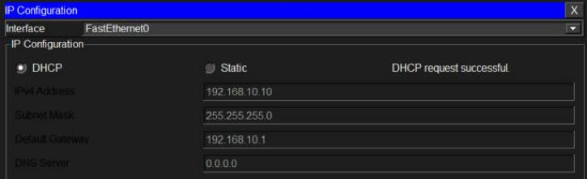
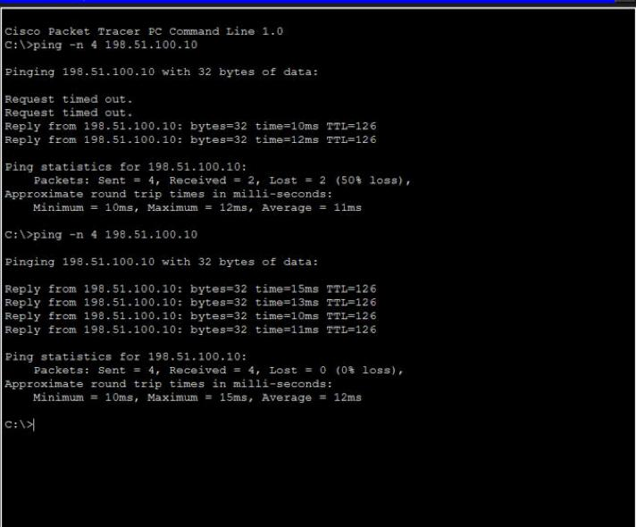
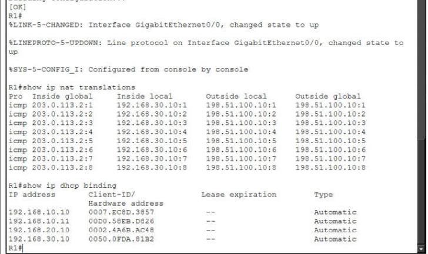

- Every PC got the right address **and gateway** for its VLAN from DHCP.
- PC-Guest → `198.51.100.10`: 4/4 replies with **TTL 126** (two routers).
- `show ip nat translations`: inside local `192.168.30.10` → inside global `203.0.113.2`, one entry per ping, told apart by the ICMP ID (`:1`, `:2`…). That's how PAT lets many devices share one address.

## Lab 4: ACLs · [`.pkt`](lab-04-acls/)

**Goal:** guests get the internet but can't touch the office.

Before the ACL, a guest could reach the office server:

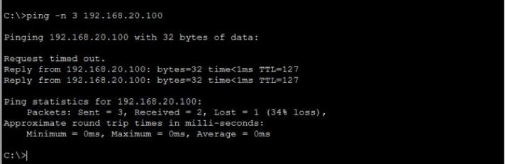

```
ip access-list extended GUEST-IN
 deny ip 192.168.30.0 0.0.0.255 192.168.10.0 0.0.0.255
 deny ip 192.168.30.0 0.0.0.255 192.168.20.0 0.0.0.255
 permit ip any any                  ! without this, the hidden "deny all" would block the internet too
interface g0/1.30
 ip access-group GUEST-IN in        ! check guest traffic as it enters the router
```

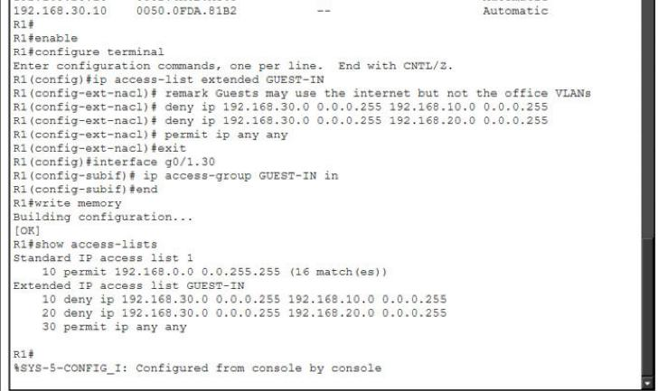
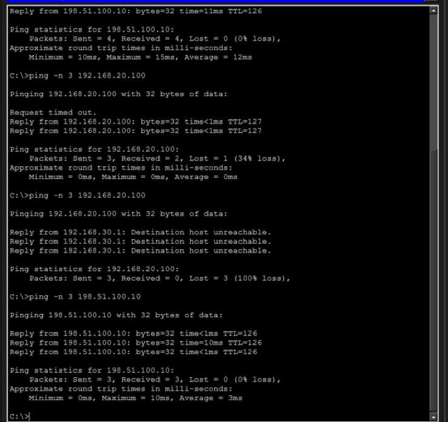

| From PC-Guest to | Before | After |
|---|---|---|
| Office-Server `192.168.20.100` | ✅ replies | ❌ *Destination host unreachable* from `192.168.30.1` |
| Internet `198.51.100.10` | ✅ | ✅ 3/3 |

## Lab 5: Port security · [`.pkt`](lab-05-port-security/)

**Goal:** a desk port only works for the device that belongs there. Anything else shuts the port down.

```
interface range fa0/3 - 5
 switchport port-security
 switchport port-security maximum 1
 switchport port-security mac-address sticky     ! learn the first device and remember it
 switchport port-security violation shutdown
```

1. PC-Sales1 sends traffic, and SW1 sticks its MAC `0007.EC8D.3857` to Fa0/3 (**Secure-up**, 0 violations).
2. I changed PC-Sales1's MAC to `00AA.BBCC.DD01` (a "different laptop" in the same jack). Pings time out.
3. SW1 logs `%PORT_SECURITY-2-PSECURE_VIOLATION … caused by MAC address 00AA.BBCC.DD01` and puts Fa0/3 in **err-disable** (Secure-shutdown, violation count 1). The link goes red.
4. Recovery: put the real device back, then `shutdown` / `no shutdown` on the port. It's back to **Secure-up**.

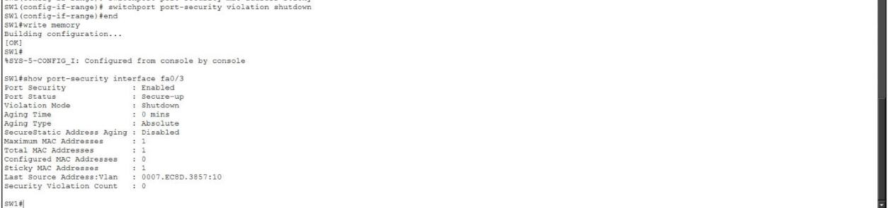
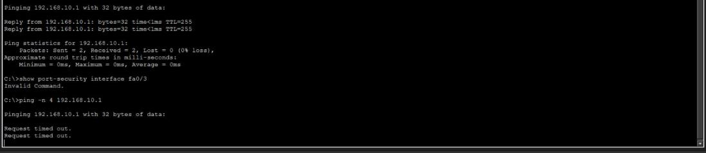
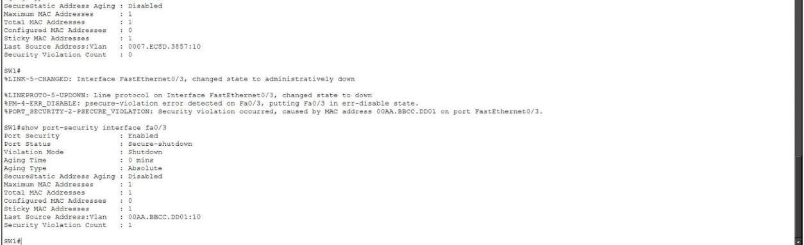
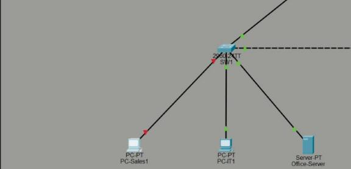
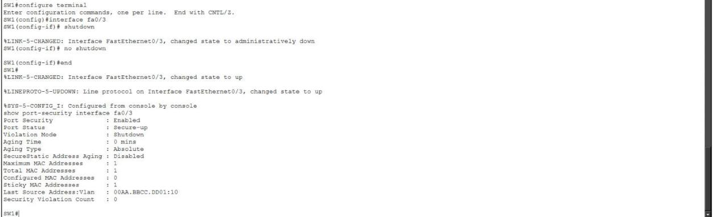

---

## What I learned

1. **VLANs separate by switch port, not by IP address.** A guest PC with a Sales IP still couldn't reach Sales. The VLAN decides who's in the same broadcast domain.
2. **A trunk carries every VLAN on one cable** by tagging frames (802.1Q). `show interfaces trunk` shows which VLANs are allowed *and* actually forwarding.
3. **Routing needs a way back.** My one real bug: the IT PCs had no default gateway. The ping reached them, but the reply had nowhere to go. "Router can ping it, other subnet can't" points straight at the far end's gateway.
4. **Troubleshoot one hop at a time.** Own gateway, then layer 2 on the switch, then router to target, then the target's settings. Each step rules out half the network.
5. **The first ping often fails, and that's normal.** The first packet waits for ARP (finding the next device's MAC), sometimes on several hops. Check the later packets before blaming the config.
6. **TTL shows the router hops.** 128 on the same subnet, 127 through R1, 126 through R1 and the ISP.
7. **DHCP needs exclusions and the right default-router per pool.** Otherwise it hands out the router's or a server's address, or a gateway in the wrong VLAN.
8. **NAT overload (PAT) is how a whole office shares one public IP.** Inside local vs inside global, and port (or ICMP ID) numbers keep each conversation separate. The ISP never needed a route to my private network.
9. **ACLs read top to bottom and end with an invisible "deny any".** The `permit ip any any` line is what kept the guests' internet working. Applying it *inbound* on the guest sub-interface filters traffic before it's routed anywhere.
10. **A denied packet can get an answer.** "Destination host unreachable" came from the router itself, not a timeout, which tells you a filter is in the way.
11. **Port security stops someone plugging into a free desk jack.** Sticky MAC learning, a limit of 1, and shutdown on violation. Recovery is a manual `shutdown` / `no shutdown`, so someone has to notice and decide.
12. **Save your work as you go.** The laptop died halfway through lab 2. Because Packet Tracer had saved the file, nothing was lost.
